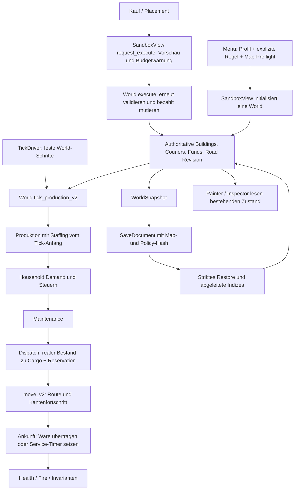

# OE-00: Architekturkarte des bestehenden Wirtschaftspfads

Erfasst am 2026-10-16 für `fef111deff4cedd3d3fa48663556d41b2e4b31a6`. Die Zeilenangaben beziehen sich auf diesen Source-Stand. Dies ist eine Source-Diagnose und ein Plan für spätere Erweiterungen; OE-00 ändert weder Simulation noch Save-Format. Testresultate und Baseline-Hashes stehen separat in [baseline.md](baseline.md). Die hier benannten Tests sind vorhandene Prüfpunkte, keine zusätzliche Behauptung, dass sie in dieser Teilanalyse ausgeführt wurden.

## Versionsinventar und Defaults

| Identität | Tatsächlicher Vertrag am erfassten HEAD | Beleg |
|---|---|---|
| Höchstes Profil | `RulesProfile::CityV16`; Profilnummer und Regelversion sind verschiedene Begriffe. | [World.h:19](../../src/simulation/World.h#L19) |
| City-v16-Regeln | Unterstützt sind 1–6; neue normale City-v16-Welten verwenden Rule4. Rule7 ist derzeit nicht unterstützt. | [World.cpp:240–253](../../src/simulation/World.cpp#L240); explizite Rule7-Ablehnung in [SandboxCityV16Tests.cpp:390–398](../../tests/SandboxCityV16Tests.cpp#L390) |
| Allgemeiner Menüdefault | Frische Settings wählen City-v11 und bezahlten Prepared Starter; City-v11 verwendet standardmäßig Rule3. Vorhandene explizite Settings bleiben eigene Eingaben. | [MenuStorage.h:11–15](../../src/app/MenuStorage.h#L11), [World.cpp:240–245](../../src/simulation/World.cpp#L240), [MenuSessionTests.cpp:303](../../tests/MenuSessionTests.cpp#L303) |
| Bridges/Ramps | Rule5 und Rule6 sind separate, ausdrücklich gewählte New-Game-Optionen. Die beiden Flags starten `false` und sind nicht gespeicherte Defaults. Bridges werden nur unter Rule5/6, Ramps nur unter Rule6 unterstützt. | [MenuSession.h:88–89](../../src/app/MenuSession.h#L88), [MenuSession.cpp:180–185](../../src/app/MenuSession.cpp#L180), [World.h:514–515](../../src/simulation/World.h#L514) |
| Direkter CLI-Default | Der direkte Sandbox-CLI-Pfad beginnt bei `LogisticsV1`, unabhängig vom Menüdefault. | [main.cpp:130](../../src/app/main.cpp#L130) |
| MapPermissions | Unterstützt sind Policy1/2/3. City-v16 Rule3→Policy1, Rule4→Policy2, Rule5/6→Policy3. | [MapPermissions.h:22–27](../../src/simulation/MapPermissions.h#L22), [MapRulesCheck.cpp:50–56](../../src/maps/MapRulesCheck.cpp#L50) |
| Save-Schemas | Der Parser akzeptiert ausschließlich 1–22. City-v16 Rule1/2→18, Rule3→19, Rule4→20, Rule5→21, Rule6→22. | [SandboxSave.cpp:616–618](../../src/persistence/SandboxSave.cpp#L616), [648](../../src/persistence/SandboxSave.cpp#L648), [734–743](../../src/persistence/SandboxSave.cpp#L734) |

**Bedingte Reservierung für spätere Tasks:** Rule7 und Schema23 kollidieren an diesem HEAD mit keiner unterstützten Produktionsidentität. Sie sind noch nicht implementiert oder aktiviert. Ihre Nutzung setzt die OE-08/OE-09-Gates und eine erneute Versionsprüfung voraus. Policy3 existiert bereits und darf hierfür nicht neu interpretiert werden. Ein bloßes Anheben der Versionsobergrenzen genügt nicht: Konstruktor, Map-Preflight, Bridge-/Ramp-Support, Save-Erstellung, Parser und Restore enthalten jeweils explizite Versionstore. Beispielsweise würden die jetzigen `bridges_supported()`/`ramps_supported()` unter Rule7 beide `false` liefern ([World.h:514–515](../../src/simulation/World.h#L514)).

## Kauf bis Ankunft und Haushalt

Die zentrale Reihenfolge ist **Produktion → Household-Demand → Maintenance → Dispatch → Bewegung/Ankunft → Health → Fire**. Eine Ankunft am Demand-Tick erfolgt also nach dessen Bedarfsprüfung und rettet diesen bereits geprüften Bedarf nicht rückwirkend. Das ist aktuelles OpenEmperor-Verhalten, keine Aussage zur Reihenfolge im Originalspiel ([World.cpp:1980–2116](../../src/simulation/World.cpp#L1980)).

| Schritt | Bestehende konkrete Stelle | Erweiterungspunkt und einzuhaltende Grenze |
|---|---|---|
| Eingabe und Kaufanfrage | `SandboxView::request_execute()` prüft `World::validate()` und kann eine Budgetwarnung öffnen. Die tatsächliche Aktion verwendet `SandboxView::execute()` → `World::execute()`. [SandboxView.cpp:2381–2449](../../src/app/SandboxView.cpp#L2381) | Neue kaufbare Sources später über denselben Command-/Funds-Pfad aufnehmen. Keine UI-Funktion darf Bestand oder House-State direkt setzen. |
| Bezahlte Mutation | `World::validate()` verwirft unbekannte/unzulässige Commands; `execute_impl()` validiert erneut, legt Building/Courier an und belastet Funds. [World.cpp:910](../../src/simulation/World.cpp#L910), [1233](../../src/simulation/World.cpp#L1233), [1327](../../src/simulation/World.cpp#L1327), [1487–1496](../../src/simulation/World.cpp#L1487) | Neue Object-/Command-/Role-Typen brauchen konsistente Validierung, Kosten, IDs, Footprint/Owner und Restore-Regeln. Bridge-/Ramp-Kauf bleibt eigener geprüfter Zweig am Anfang von `execute_impl()`. |
| Zeit und Tick | `SandboxView::update()` ruft den vorhandenen `TickDriver` auf; `tick_once()` verwendet dieselbe `World::tick()`. Der Driver arbeitet mit `1/Rules::ticks_per_second`; aktuell 20 Hz. [SandboxView.cpp:2362–2379](../../src/app/SandboxView.cpp#L2362), [World.cpp:3768–3783](../../src/simulation/World.cpp#L3768), [World.h:102](../../src/simulation/World.h#L102) | Ein späterer Originalzyklus benötigt einen versionierten, gespeicherten Scheduler. Aus 20 Hz folgt keine originale Zyklusdauer. Kein Wallclock-/Render-Timer als Wirtschaftsauthority. |
| Produktion und Staffing | `tick_production_v2()` prüft Überläufe, erfasst Staffing vor der Tick-Mutation, produziert Clay/Pottery/Food und respektiert die bestehenden Produktionskapazitäten. [World.cpp:1980–2051](../../src/simulation/World.cpp#L1980) | Neue Goods nur mit realer, bezahlter Source und Bilanz. Alte Profilzweige und die stabile Reihenfolge bleiben unverändert. |
| Zielwahl und Transport | `courier_dispatch_status()` und vorbereitete Routen bestimmen Dispatch; `dispatch_v2()` prüft Relation, Road-Revision, Zielkapazität, Stock und Reservation vor der Mutation. [World.cpp:1756](../../src/simulation/World.cpp#L1756), [2119–2250](../../src/simulation/World.cpp#L2119) | Vorhandenes Routing und Reservationen erweitern, keinen zweiten Navigator einführen. Ein ausgewähltes Ziel oder eine Route beweist noch keine Lieferung. |
| Tatsächliche Ankunft | `move_v2()` bewegt Kante für Kante und mutiert das Ziel erst nach Erreichen des Routenendes. Goods verlassen Cargo/Reservation und werden Stock; Service setzt `service_until_tick`, Health/Fire haben getrennte Arrival-Zweige. Danach folgt der normale Rückweg. [World.cpp:2317–2398](../../src/simulation/World.cpp#L2317) | Original-Servicekategorien später ausschließlich durch passende tatsächliche Ankünfte aktivieren. Keine Render- oder Dispatch-Events als Visit. |
| Household-Demand | Alle 400 World-Ticks pro platziertem Haus prüft die Produktion `household_demand_status(home,ticks_)`; Erfolg verbraucht vorhandenes Pottery/Food, verbucht tatsächliche Steuern und verändert Population nach bestehenden Regeln. [World.cpp:2052–2106](../../src/simulation/World.cpp#L2052) | Späteren Rule7-Konsum/House-Zyklus getrennt versionieren. Keine Umdeutung vorhandener kumulativer Counter oder der alten Demand-Phase. |
| Gegenwärtiger Bedarf und Steuern | Der gemeinsame pure Bedarfscheck verlangt Waren, ggf. aktive Serviceabdeckung und kein Feuer/Krankheit. Service ist nur gültig bei `service_until_tick > evaluation_tick`. Steuern nutzen aktuelle Regeln und effektive Stufe. [WorldMaintenance.cpp:88–118](../../src/simulation/WorldMaintenance.cpp#L88) | Neue Timer/Warenmodelle müssen auch die arithmetische Maintenance-Vorprüfung berücksichtigen; diese prüft den nächsten Demand vor jeder Mutation ([121](../../src/simulation/WorldMaintenance.cpp#L121)). |
| Bisherige Hausstufe | Historische Stufe 0/1/2 kommt aus kumulativ erfüllten Bedarfen; effektive Stufe wird durch Water/Desirability begrenzt. Die Kapazitäten sind 6/10/16. [World.cpp:661–689](../../src/simulation/World.cpp#L661), [World.h:144–146](../../src/simulation/World.h#L144) | Die geplanten 15 Original-Hausmodelle sind keine Erweiterung dieses Zahlenbereichs per Cast. Eigene getypte, versionierte Authority mit klarer Abbildung ist erforderlich. |
| Bisherige Desirability | Authored Object-Gewichte, Manhattan-Abstand zwischen Footprints, abgestufte Radiusbeiträge und Clamp. [WorldDesirability.cpp:18–47](../../src/simulation/WorldDesirability.cpp#L18), [58–85](../../src/simulation/WorldDesirability.cpp#L58) | Ein Originalkern darf diese alte City-v13+-Funktion nicht still ersetzen. Echte platzierte Quellen sind die spätere Runtime-Eingabe, nicht ähnliche Sprite-/Modellnamen. |

## Snapshot, Save und Session

`BuildingState`/`CourierState` sind Laufzeitdaten; `BuildingSnapshot`/`CourierSnapshot` halten die gespeicherte Authority. `WorldSnapshot` umfasst IDs, Tick-/Command-/Road-Revision, Waren, Population, Ledger sowie BridgeSpan/RampLink. Route-Caches und abgeleitete Occupancy/Indizes sind nicht zweite Save-Authority ([World.h:402–500](../../src/simulation/World.h#L402)). `World::snapshot()` kopiert diese Felder, während `restore_impl()` Regelversion, Eingaben und Invarianten erneut prüft ([World.cpp:3246–3325](../../src/simulation/World.cpp#L3246)).

`SandboxView::capture_save_document()` verwendet `make_document()`; F5 schreibt den normalen Savepfad. F9 liest/validiert einen Ersatz, veröffentlicht ihn erst danach, bereitet Präsentationscaches neu vor und pausiert ([SandboxView.cpp:201–255](../../src/app/SandboxView.cpp#L201)). `make_document()` bindet Map-SHA, Buildable-Mask-SHA, Snapshot und für City-v16 Rule3–6 den unveränderlichen MapPermissions-Fingerprint ([SandboxSave.cpp:760–775](../../src/persistence/SandboxSave.cpp#L760)). Restore prüft dieselben tatsächlichen Quellen/Fingerprints ([835–864](../../src/persistence/SandboxSave.cpp#L835)).

Die neuen Regeln benötigen später eine ausdrückliche Schema23-Serialisierung und -Validierung. Die bestehenden numerischen Guards dürfen nicht pauschal von `<=22` auf `<=23` angehoben werden, weil etliche alte Felder nach Schemagrenzen zugelassen werden. Bridge-Authority ist nur Schema21/22, Ramp-Authority nur Schema22; diese bisherigen Ablehnungen bleiben erhalten ([SandboxSave.cpp:300–302](../../src/persistence/SandboxSave.cpp#L300)). Für alte Dokumente gilt das alte Format, keine automatische Rule7-Migration. Bereits bestehende Schema1-Kompatibilität und ausdrücklich bestätigte City-v11-Kopieupgrades sind historische, getrennte Pfade ([SandboxSave.cpp:746–751](../../src/persistence/SandboxSave.cpp#L746), [SandboxSave.h:37–38](../../src/persistence/SandboxSave.h#L37)).

Hinweis zur Quellenqualität: Der Kommentar in `SaveDocument` nennt noch nur Schema19/20 ([SandboxSave.h:21](../../src/persistence/SandboxSave.h#L21)); der tatsächlich ausgeführte Parser/Writer/Restore behandelt auch21/22 wie oben belegt. OE-00 ändert diesen Produktionsheader nicht. Der Kommentar ist kein Beleg dafür, dass Bridges/Ramps nicht gespeichert würden.

Das Menü entscheidet neue Regel/Policy vor dem Map-Preflight und verwendet bei geladenen Dokumenten deren gespeichertes Profil/Regelversion ([MenuSession.cpp:180–185](../../src/app/MenuSession.cpp#L180), [216–247](../../src/app/MenuSession.cpp#L216)). Spätere Modellbindung muss deshalb sowohl Create als auch Restore prüfen; ein nur im New-Game-Menü gewähltes Modell reicht nicht.

## Painter und Inspector

Die Darstellung liest die World. Hausgrafikrollen werden über `World::household_level()` ausgewählt ([SandboxView.cpp:835–843](../../src/app/SandboxView.cpp#L835)); Gebäudefüße und Footprints verwenden die gemeinsamen Geometriehelfer ([World.cpp:127–154](../../src/simulation/World.cpp#L127), [SandboxView.cpp:2858–2866](../../src/app/SandboxView.cpp#L2858)). Die spätere Originalhausdarstellung muss den neuen getypten House-State gezielt in eine geprüfte VisualRole überführen. Eine Sprite-ID erzeugt weder Gebäudegröße noch Bewohnbarkeit oder neue Transportrechte.

`draw_world()` bildet Building-/Courier-DrawInstances aus bestehendem Zustand; der Walker verwendet gespeicherten Path-/Tickfortschritt und vorbereitete Spriteframes ([SandboxView.cpp:2986–3005](../../src/app/SandboxView.cpp#L2986), [3069–3083](../../src/app/SandboxView.cpp#L3069)). Road-Ground kommt vor den räumlichen Objekten. Der vorhandene Painter mischt bereits sortierte Original-/Sandbox-Streams über `WorldDrawKey(depth,ground_x,layer,stable_id)` ([SandboxView.cpp:3214–3246](../../src/app/SandboxView.cpp#L3214), [WorldDrawOrder.h:9–61](../../src/scene/WorldDrawOrder.h#L9)). Er behauptet ausdrücklich keine originale Z-Reihenfolge. Ein neuer Housing-State gehört nicht in einen per-Frame-Dateiparser oder einen alternativen Painter.

Die Inspektor-/HUD-Erweiterung sitzt im bestehenden Household-Detailpfad und in `draw_hud()` ([SandboxView.cpp:3757–3788](../../src/app/SandboxView.cpp#L3757), [4406](../../src/app/SandboxView.cpp#L4406)). Bereit zur Diagnose ist aktueller Bestand/Timer; ein zukünftiger Dispatch oder momentaner HUD-Miss ist kein Nachweis einer vergangenen Deadline oder garantierten nächsten Versorgung.

## Vorhandene Prüfstellen für spätere Änderungen

| Vertrag | Source-Fixture / registrierter CTest |
|---|---|
| City-v16 Wartung, Überläufe, Saved-State, Determinismus, 20k-Ticks, Geometrie und Rule7-Ablehnung | [SandboxCityV16Tests.cpp:248](../../tests/SandboxCityV16Tests.cpp#L248), [306](../../tests/SandboxCityV16Tests.cpp#L306), [390](../../tests/SandboxCityV16Tests.cpp#L390); `sandbox-city-v16-{base,persistence,balance,determinism,endurance,geometry,determinism-v2,endurance-v2}` ([CMakeLists.txt:655–662](../../CMakeLists.txt#L655)) |
| Historische Save-Schemas, Snapshotgleichheit und Fortsetzung | [SandboxSaveTests.cpp:55–265](../../tests/SandboxSaveTests.cpp#L55); `sandbox-save-resume` ([CMakeLists.txt:509](../../CMakeLists.txt#L509)) |
| Unveränderliche MapPermissions gegen Präsentationszustand | [SandboxMapPermissionsTests.cpp:29](../../tests/SandboxMapPermissionsTests.cpp#L29); `sandbox-map-permissions` ([CMakeLists.txt:493–496](../../CMakeLists.txt#L493)) |
| Policy2/Schema20, kompletter Schema19-Dokumentvergleich, Neustart und Recovery | [OriginalRoadSaveTests.cpp:123](../../tests/OriginalRoadSaveTests.cpp#L123), [174–179](../../tests/OriginalRoadSaveTests.cpp#L174), [244–258](../../tests/OriginalRoadSaveTests.cpp#L244); `original-road-save-recovery` ([CMakeLists.txt:541–545](../../CMakeLists.txt#L541)) |
| Rule6-Rampentransport, fehlgeschlagene Commands, signierte Höhen, Mid-edge-Restore und deterministische Fortsetzung | [RampTransportTests.cpp:21–39](../../tests/RampTransportTests.cpp#L21), [125–128](../../tests/RampTransportTests.cpp#L125); `ramp-transport` ([CMakeLists.txt:1181–1184](../../CMakeLists.txt#L1181)) |
| Bridge-Transport und Rendering | [BridgeTransportTests.cpp](../../tests/BridgeTransportTests.cpp), [BridgeRenderingTests.cpp](../../tests/BridgeRenderingTests.cpp); `bridge-transport`, `bridge-rendering-pixels` ([CMakeLists.txt:529–536](../../CMakeLists.txt#L529)) |
| Menüsettings/Load/Kopieupgrades und expliziter Bridge-Opt-in | [MenuSessionTests.cpp:303](../../tests/MenuSessionTests.cpp#L303), [521–558](../../tests/MenuSessionTests.cpp#L521), [MenuMapRulesTests.cpp:365–392](../../tests/MenuMapRulesTests.cpp#L365); `menu-session-flow` und `menu-map-rules-selection` ([CMakeLists.txt:436](../../CMakeLists.txt#L436)) |
| Produktionspainter statt nur isolierter Hilfsfunktion | [SceneCompositionTests.cpp](../../tests/SceneCompositionTests.cpp), [UnifiedPainterTests.cpp](../../tests/UnifiedPainterTests.cpp); `scene-composition-production-pixels`, `unified-map-sandbox-pixels` ([CMakeLists.txt:973–990](../../CMakeLists.txt#L973)) |

Diese Architekturkarte belegt ausschließlich den aktuellen OpenEmperor-Pfad. Die Existenz eines künftigen Model-Parsers, Originaltimer, 15 produktiver Hausstufen oder vollständiger Originalwarenketten wird damit nicht behauptet. Der selektive Fork-Vergleich und seine Original-Beweisgrenzen stehen im separaten OE-00-Gap-Report. Kein Bestandteil dieser Teilanalyse liest oder kopiert proprietäre Model-/Sprite-/EXE-Bytes in Git.
